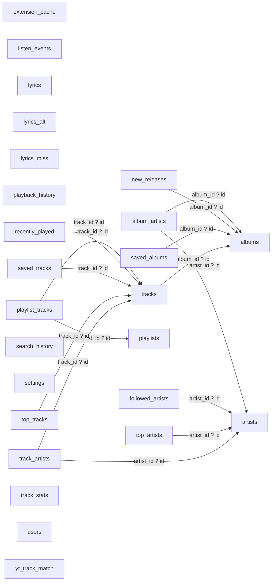

# Native data ownership and schema network

Derived from all thirteen actual native migrations executed in an in-memory SQLite database. Runtime database setup is src-tauri/src/db/connection.rs. Historical drizzle files are not the runtime schema. This map documents all final tables and their constraints, not the application database contents.

## Ownership and lifetime

| Data family | Writers / readers | Lifetime and performance contract |
| --- | --- | --- |
| Settings | Auth, credentials metadata, preference/bootstrap commands | Indexed keys; preserve explicit signout exclusions and avoid exposing secret session settings to JS. |
| Catalogue and associations | Search/detail/internal metadata/library sync; local pages, Stats/recommendation hydration | Batched dependency-complete writes; COALESCE image/genre/ISRC preservation; distinguish cached catalogue from followed membership. |
| Library memberships / playlist occurrences | Sync and save/follow/edit commands; sidebar and list/detail queries | Atomic account/revision commits. Current cached playlist track key cannot represent repeated occurrences. |
| Play / taste events and summaries | App listen tracker plus record_listen_event/recommend engine; Stats and discovery | Raw taste events are trimmed to 180 days/12,000 entries every fifty signals; aggregate consistency and account ownership matter. |
| Lyric payloads, alternates and provider misses | Provider coordinator/cache and source-switch commands | Parsed timing/voice documents, version checks and negative TTLs; source switch remains cached/offline. |
| YouTube match table | Automatic matcher and manual match commands | Pins dominate automatic results; negative matches expire after fourteen days; preserve recording identity. |
| Internal JSON/extension/media caches | Pathfinder/SpClient command families | Fresh/live/stale policy, account/market/revision keys and guarded fills; byte/age budgets needed. |

## All foreign-key edges

## Every final table definition

### album_artists

| Column | SQL type | Required | Default | Primary-key ordinal |
| --- | --- | --- | --- | --- |
| album_id | TEXT | True | None | 1 |
| artist_id | TEXT | True | None | 2 |
| position | INTEGER | True | 0 | 0 |

Indexes (including SQLite primary-key indexes):

- `idx_album_artists_artist`: artist_id; unique=False; origin=c.
- `sqlite_autoindex_album_artists_1`: album_id, artist_id; unique=True; origin=pk.

Foreign keys:

- artist_id ? artists.id; update NO ACTION, delete CASCADE.
- album_id ? albums.id; update NO ACTION, delete CASCADE.

### albums

| Column | SQL type | Required | Default | Primary-key ordinal |
| --- | --- | --- | --- | --- |
| id | TEXT | True | None | 1 |
| name | TEXT | True | None | 0 |
| album_type | TEXT | True | 'album' | 0 |
| image_url | TEXT | False | None | 0 |
| release_date | TEXT | False | None | 0 |
| total_tracks | INTEGER | True | 0 | 0 |
| genres | TEXT | False | None | 0 |
| popularity | INTEGER | False | None | 0 |
| updated_at | INTEGER | True | None | 0 |

Indexes (including SQLite primary-key indexes):

- `sqlite_autoindex_albums_1`: id; unique=True; origin=pk.

Foreign keys:

- None.

### artists

| Column | SQL type | Required | Default | Primary-key ordinal |
| --- | --- | --- | --- | --- |
| id | TEXT | True | None | 1 |
| name | TEXT | True | None | 0 |
| image_url | TEXT | False | None | 0 |
| genres | TEXT | False | None | 0 |
| popularity | INTEGER | False | None | 0 |
| updated_at | INTEGER | True | None | 0 |

Indexes (including SQLite primary-key indexes):

- `sqlite_autoindex_artists_1`: id; unique=True; origin=pk.

Foreign keys:

- None.

### extension_cache

| Column | SQL type | Required | Default | Primary-key ordinal |
| --- | --- | --- | --- | --- |
| entity_uri | TEXT | True | None | 1 |
| kind | TEXT | True | None | 2 |
| payload | BLOB | True | None | 0 |
| fetched_at | INTEGER | True | None | 0 |

Indexes (including SQLite primary-key indexes):

- `idx_extension_cache_fetched`: fetched_at; unique=False; origin=c.
- `sqlite_autoindex_extension_cache_1`: entity_uri, kind; unique=True; origin=pk.

Foreign keys:

- None.

### followed_artists

| Column | SQL type | Required | Default | Primary-key ordinal |
| --- | --- | --- | --- | --- |
| artist_id | TEXT | True | None | 1 |
| followed_at | INTEGER | True | None | 0 |

Indexes (including SQLite primary-key indexes):

- `idx_followed_artists_followed_at`: followed_at; unique=False; origin=c.
- `sqlite_autoindex_followed_artists_1`: artist_id; unique=True; origin=pk.

Foreign keys:

- artist_id ? artists.id; update NO ACTION, delete CASCADE.

### listen_events

| Column | SQL type | Required | Default | Primary-key ordinal |
| --- | --- | --- | --- | --- |
| id | INTEGER | True | None | 1 |
| track_id | TEXT | True | None | 0 |
| event_type | TEXT | True | None | 0 |
| ms_played | INTEGER | True | 0 | 0 |
| track_duration_ms | INTEGER | True | 0 | 0 |
| context_type | TEXT | False | None | 0 |
| context_id | TEXT | False | None | 0 |
| occurred_at | INTEGER | True | None | 0 |

Indexes (including SQLite primary-key indexes):

- `idx_listen_events_track`: track_id, occurred_at; unique=False; origin=c.
- `idx_listen_events_at`: occurred_at; unique=False; origin=c.

Foreign keys:

- None.

### lyrics

| Column | SQL type | Required | Default | Primary-key ordinal |
| --- | --- | --- | --- | --- |
| track_id | TEXT | False | None | 1 |
| synced_lrc | TEXT | False | None | 0 |
| plain | TEXT | False | None | 0 |
| source | TEXT | True | None | 0 |
| instrumental | INTEGER | True | 0 | 0 |
| found | INTEGER | True | 0 | 0 |
| fetched_at | INTEGER | True | None | 0 |
| payload | TEXT | False | None | 0 |
| offset_ms | INTEGER | True | 0 | 0 |
| schema_version | INTEGER | True | 0 | 0 |
| word_level | INTEGER | True | 0 | 0 |

Indexes (including SQLite primary-key indexes):

- `sqlite_autoindex_lyrics_1`: track_id; unique=True; origin=pk.

Foreign keys:

- None.

### lyrics_alt

| Column | SQL type | Required | Default | Primary-key ordinal |
| --- | --- | --- | --- | --- |
| track_id | TEXT | True | None | 1 |
| source | TEXT | True | None | 2 |
| payload | TEXT | True | None | 0 |
| word_level | INTEGER | True | 0 | 0 |
| synced | INTEGER | True | 0 | 0 |
| fetched_at | INTEGER | True | None | 0 |

Indexes (including SQLite primary-key indexes):

- `idx_lyrics_alt_track`: track_id; unique=False; origin=c.
- `sqlite_autoindex_lyrics_alt_1`: track_id, source; unique=True; origin=pk.

Foreign keys:

- None.

### lyrics_miss

| Column | SQL type | Required | Default | Primary-key ordinal |
| --- | --- | --- | --- | --- |
| track_id | TEXT | True | None | 1 |
| source | TEXT | True | None | 2 |
| fetched_at | INTEGER | True | None | 0 |

Indexes (including SQLite primary-key indexes):

- `idx_lyrics_miss_track`: track_id; unique=False; origin=c.
- `sqlite_autoindex_lyrics_miss_1`: track_id, source; unique=True; origin=pk.

Foreign keys:

- None.

### new_releases

| Column | SQL type | Required | Default | Primary-key ordinal |
| --- | --- | --- | --- | --- |
| album_id | TEXT | True | None | 1 |
| position | INTEGER | True | None | 0 |

Indexes (including SQLite primary-key indexes):

- `idx_new_releases_pos`: position; unique=False; origin=c.
- `sqlite_autoindex_new_releases_1`: album_id; unique=True; origin=pk.

Foreign keys:

- album_id ? albums.id; update NO ACTION, delete CASCADE.

### playback_history

| Column | SQL type | Required | Default | Primary-key ordinal |
| --- | --- | --- | --- | --- |
| id | INTEGER | True | None | 1 |
| track_id | TEXT | True | None | 0 |
| context_type | TEXT | False | None | 0 |
| context_id | TEXT | False | None | 0 |
| played_at | INTEGER | True | None | 0 |
| duration_ms | INTEGER | False | None | 0 |

Indexes (including SQLite primary-key indexes):

- `idx_playback_history_played_at`: played_at; unique=False; origin=c.

Foreign keys:

- None.

### playlist_tracks

| Column | SQL type | Required | Default | Primary-key ordinal |
| --- | --- | --- | --- | --- |
| playlist_id | TEXT | True | None | 1 |
| track_id | TEXT | True | None | 2 |
| position | INTEGER | True | 0 | 0 |
| added_at | INTEGER | True | None | 0 |
| added_by | TEXT | False | None | 0 |

Indexes (including SQLite primary-key indexes):

- `idx_playlist_tracks_pos`: playlist_id, position; unique=False; origin=c.
- `sqlite_autoindex_playlist_tracks_1`: playlist_id, track_id; unique=True; origin=pk.

Foreign keys:

- track_id ? tracks.id; update NO ACTION, delete CASCADE.
- playlist_id ? playlists.id; update NO ACTION, delete CASCADE.

### playlists

| Column | SQL type | Required | Default | Primary-key ordinal |
| --- | --- | --- | --- | --- |
| id | TEXT | True | None | 1 |
| name | TEXT | True | None | 0 |
| description | TEXT | False | None | 0 |
| owner_id | TEXT | False | None | 0 |
| image_url | TEXT | False | None | 0 |
| total_tracks | INTEGER | True | 0 | 0 |
| is_public | INTEGER | True | 0 | 0 |
| is_local | INTEGER | True | 0 | 0 |
| snapshot_id | TEXT | False | None | 0 |
| updated_at | INTEGER | True | None | 0 |

Indexes (including SQLite primary-key indexes):

- `idx_playlists_snapshot`: snapshot_id; unique=False; origin=c.
- `sqlite_autoindex_playlists_1`: id; unique=True; origin=pk.

Foreign keys:

- None.

### recently_played

| Column | SQL type | Required | Default | Primary-key ordinal |
| --- | --- | --- | --- | --- |
| track_id | TEXT | True | None | 1 |
| played_at | INTEGER | True | None | 2 |

Indexes (including SQLite primary-key indexes):

- `idx_recently_played_at`: played_at; unique=False; origin=c.
- `sqlite_autoindex_recently_played_1`: track_id, played_at; unique=True; origin=pk.

Foreign keys:

- track_id ? tracks.id; update NO ACTION, delete CASCADE.

### saved_albums

| Column | SQL type | Required | Default | Primary-key ordinal |
| --- | --- | --- | --- | --- |
| album_id | TEXT | True | None | 1 |
| added_at | INTEGER | True | None | 0 |

Indexes (including SQLite primary-key indexes):

- `idx_saved_albums_added_at`: added_at; unique=False; origin=c.
- `sqlite_autoindex_saved_albums_1`: album_id; unique=True; origin=pk.

Foreign keys:

- album_id ? albums.id; update NO ACTION, delete CASCADE.

### saved_tracks

| Column | SQL type | Required | Default | Primary-key ordinal |
| --- | --- | --- | --- | --- |
| track_id | TEXT | True | None | 1 |
| added_at | INTEGER | True | None | 0 |

Indexes (including SQLite primary-key indexes):

- `idx_saved_tracks_added`: added_at; unique=False; origin=c.
- `idx_saved_tracks_added_at`: added_at; unique=False; origin=c.
- `sqlite_autoindex_saved_tracks_1`: track_id; unique=True; origin=pk.

Foreign keys:

- track_id ? tracks.id; update NO ACTION, delete CASCADE.

### search_history

| Column | SQL type | Required | Default | Primary-key ordinal |
| --- | --- | --- | --- | --- |
| id | INTEGER | True | None | 1 |
| query | TEXT | True | None | 0 |
| result_type | TEXT | False | None | 0 |
| result_id | TEXT | False | None | 0 |
| searched_at | INTEGER | True | None | 0 |

Indexes (including SQLite primary-key indexes):

- `idx_search_history_searched_at`: searched_at; unique=False; origin=c.

Foreign keys:

- None.

### settings

| Column | SQL type | Required | Default | Primary-key ordinal |
| --- | --- | --- | --- | --- |
| key | TEXT | True | None | 1 |
| value | TEXT | True | None | 0 |
| updated_at | INTEGER | True | None | 0 |

Indexes (including SQLite primary-key indexes):

- `sqlite_autoindex_settings_1`: key; unique=True; origin=pk.

Foreign keys:

- None.

### top_artists

| Column | SQL type | Required | Default | Primary-key ordinal |
| --- | --- | --- | --- | --- |
| time_range | TEXT | True | None | 1 |
| artist_id | TEXT | True | None | 2 |
| position | INTEGER | True | None | 0 |

Indexes (including SQLite primary-key indexes):

- `idx_top_artists_range`: time_range, position; unique=False; origin=c.
- `sqlite_autoindex_top_artists_1`: time_range, artist_id; unique=True; origin=pk.

Foreign keys:

- artist_id ? artists.id; update NO ACTION, delete CASCADE.

### top_tracks

| Column | SQL type | Required | Default | Primary-key ordinal |
| --- | --- | --- | --- | --- |
| time_range | TEXT | True | None | 1 |
| track_id | TEXT | True | None | 2 |
| position | INTEGER | True | None | 0 |

Indexes (including SQLite primary-key indexes):

- `idx_top_tracks_range`: time_range, position; unique=False; origin=c.
- `sqlite_autoindex_top_tracks_1`: time_range, track_id; unique=True; origin=pk.

Foreign keys:

- track_id ? tracks.id; update NO ACTION, delete CASCADE.

### track_artists

| Column | SQL type | Required | Default | Primary-key ordinal |
| --- | --- | --- | --- | --- |
| track_id | TEXT | True | None | 1 |
| artist_id | TEXT | True | None | 2 |
| position | INTEGER | True | 0 | 0 |

Indexes (including SQLite primary-key indexes):

- `idx_track_artists_artist`: artist_id; unique=False; origin=c.
- `sqlite_autoindex_track_artists_1`: track_id, artist_id; unique=True; origin=pk.

Foreign keys:

- artist_id ? artists.id; update NO ACTION, delete CASCADE.
- track_id ? tracks.id; update NO ACTION, delete CASCADE.

### track_stats

| Column | SQL type | Required | Default | Primary-key ordinal |
| --- | --- | --- | --- | --- |
| track_id | TEXT | True | None | 1 |
| play_count | INTEGER | True | 0 | 0 |
| complete_count | INTEGER | True | 0 | 0 |
| skip_count | INTEGER | True | 0 | 0 |
| early_skip_count | INTEGER | True | 0 | 0 |
| last_played_at | INTEGER | False | None | 0 |
| last_skipped_at | INTEGER | False | None | 0 |
| last_completed_at | INTEGER | False | None | 0 |
| updated_at | INTEGER | True | None | 0 |

Indexes (including SQLite primary-key indexes):

- `idx_track_stats_last_skipped`: last_skipped_at; unique=False; origin=c.
- `idx_track_stats_last_played`: last_played_at; unique=False; origin=c.
- `sqlite_autoindex_track_stats_1`: track_id; unique=True; origin=pk.

Foreign keys:

- None.

### tracks

| Column | SQL type | Required | Default | Primary-key ordinal |
| --- | --- | --- | --- | --- |
| id | TEXT | True | None | 1 |
| name | TEXT | True | None | 0 |
| album_id | TEXT | False | None | 0 |
| duration_ms | INTEGER | True | 0 | 0 |
| track_number | INTEGER | True | 0 | 0 |
| disc_number | INTEGER | True | 1 | 0 |
| explicit | INTEGER | True | 0 | 0 |
| popularity | INTEGER | False | None | 0 |
| preview_url | TEXT | False | None | 0 |
| is_local | INTEGER | True | 0 | 0 |
| updated_at | INTEGER | True | None | 0 |
| isrc | TEXT | False | None | 0 |

Indexes (including SQLite primary-key indexes):

- `idx_tracks_album_id`: album_id; unique=False; origin=c.
- `sqlite_autoindex_tracks_1`: id; unique=True; origin=pk.

Foreign keys:

- album_id ? albums.id; update NO ACTION, delete SET NULL.

### users

| Column | SQL type | Required | Default | Primary-key ordinal |
| --- | --- | --- | --- | --- |
| id | TEXT | True | None | 1 |
| display_name | TEXT | False | None | 0 |
| email | TEXT | False | None | 0 |
| product | TEXT | False | None | 0 |
| image_url | TEXT | False | None | 0 |
| country | TEXT | False | None | 0 |
| updated_at | INTEGER | True | None | 0 |

Indexes (including SQLite primary-key indexes):

- `sqlite_autoindex_users_1`: id; unique=True; origin=pk.

Foreign keys:

- None.

### yt_track_match

| Column | SQL type | Required | Default | Primary-key ordinal |
| --- | --- | --- | --- | --- |
| track_id | TEXT | False | None | 1 |
| video_id | TEXT | False | None | 0 |
| score | REAL | False | None | 0 |
| reason | TEXT | False | None | 0 |
| duration_ms | INTEGER | False | None | 0 |
| pinned | INTEGER | True | 0 | 0 |
| checked_at | INTEGER | True | None | 0 |

Indexes (including SQLite primary-key indexes):

- `idx_yt_track_match_checked`: checked_at; unique=False; origin=c.
- `sqlite_autoindex_yt_track_match_1`: track_id; unique=True; origin=pk.

Foreign keys:

- None.

