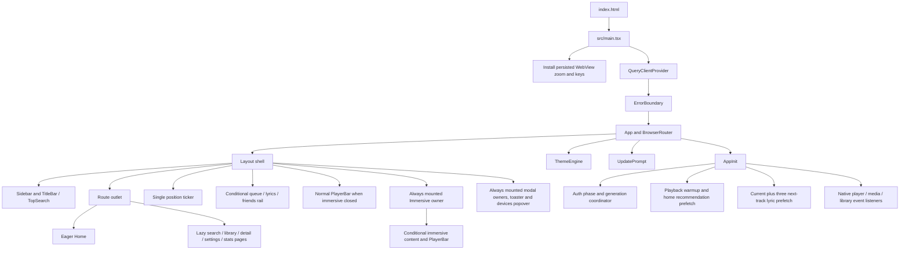
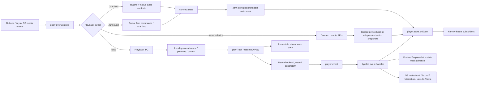
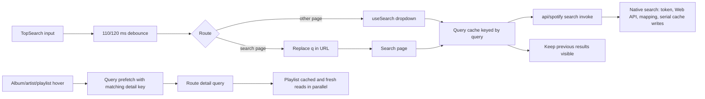
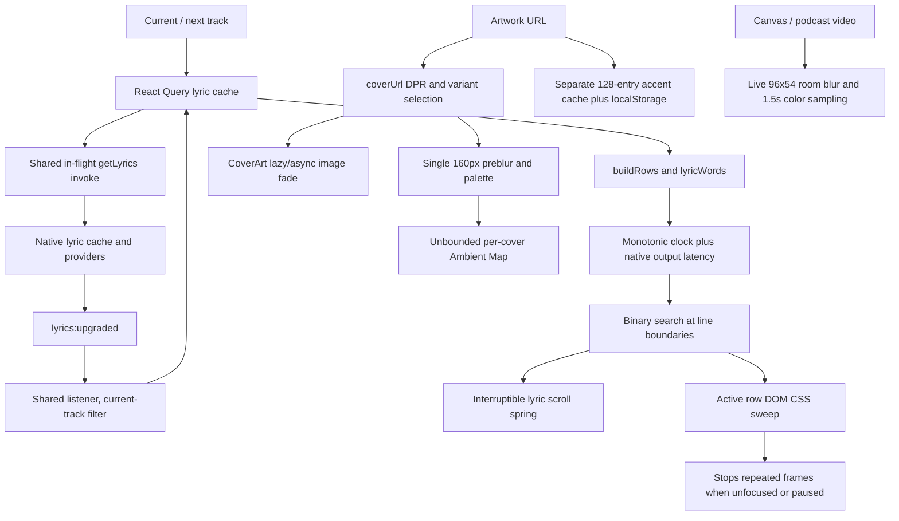

# System and playback networks

This is the static system map after all 540 original project files were reviewed. It describes current behavior. Proposed changes belong in performance_audit.md. The audit did not launch the application or change its state.

The complete per-file networks are [frontend imports](dependency_map.md), [every rendered JSX tag/component](render_graph.md), [every JSX event handler](interaction_inventory.md), [native commands/events/module imports](native_ipc_map.md), [all database tables](data_map.md), and [all lock records and dependency edges](dependency_lock_review.md). CSS and inline rendering attributes are recorded in style_inventory.md and render_attributes.md.

## Startup and rendering

The hidden/inert shell stays mounted under the immersive overlay. Its base PlayerBar unmounts, but route queries and stores can still do work. Immersive's cover hook also runs when closed. Source imports, including dynamic imports, are listed per file in [dependency_map.md](dependency_map.md).

## Controls and queue ownership

Local contexts keep full metadata in `contextTracks`, upcoming `queue`, and bounded `history`. Queue persistence serializes capped snapshots. Jam control is separate: Spirc owns progression and preloading; AppInit avoids local advancement for Jam events. Remote controls use Spotify's device queue. The immersive queue currently displays the local queue, so its behavior must be tested across all three owners before optimizing it.

## Search and detail loading

Frontend query-key isolation prevents a late old search result from replacing a newer result. There is no search cancellation signal in the current adapter or native search command. Native search requests up to twenty items per category and waits for artist/album/track cache writes plus history before returning. Native shared response/inflight caching is absent on this path.

## Lyrics and artwork

Each cache has a different lifetime and cost. The query cache can hold lyric documents for an hour, the ambient cache holds JPEG strings for the process lifetime, and persistent accents create a key per cover. Their accounting must remain separate.

## Native bootstrap, authentication and teardown

~~~mermaid
flowchart TD
  Boot["main.rs / lib.rs native boot"] --> Platform["Crash diagnostics, Windows identity/WebView args, native material"]
  Boot --> Setup["Tauri setup"]
  Setup --> KeyRead["Blocking-worker stored credential read"]
  Setup --> Database["SQLite open / 13 migrations / WAL / pool"]
  KeyRead --> Commit["Auth initialization and coherent account state"]
  Database --> Commit
  Commit --> Managed["AppState + PlaybackState + media/Discord worker"]
  Managed --> NativeWarm["Background playback warmup"]
  Managed --> LibraryLoop["Auth refresh and library sync loops"]
  Managed --> Window["Main window reveal and tray/window lifecycle"]
  Browser["SignInPrompt / Settings action"] --> AuthCmd["start_login / authorize_playback"]
  AuthCmd --> TwoGrants["Web API and playback browser grants"]
  TwoGrants --> Callback["Loopback callback listener / token exchange"]
  Callback --> Guards["Auth generation, refresh and session-commit locks"]
  Guards --> Credentials["OS keyring + settings/profile snapshot"]
  Credentials --> Managed
  Logout["logout / new account"] --> Invalidate["Invalidate auth epoch and callback ownership"]
  Invalidate --> Stop["Playback shutdown and sync gate"]
  Stop --> Purge["Account data / caches / credential cleanup"]
  Purge --> Preserve["Preserve app/device/custom credentials and separate Last.fm settings"]
~~~

Setup waits for database/auth readiness; stored credential reading already overlaps database setup. Playback warmup runs in the background. Moving setup work must preserve the point at which managed state is safe to access. Interactive auth must retain the user's existing dual-grant, same-account flow.

PlaybackInner has an explicit bounded shutdown path. Some replacement paths merely drop the inner; its Drop does not perform equivalent task-group teardown. The vendor Dealer can retain Session through its reconnect closure. Consequently replacement ownership, rather than the existence of a shutdown function, is the important resource boundary.

## Request families and admission boundaries

~~~mermaid
flowchart LR
  Cmd["149 registered native commands"] --> OAuth["OAuth Web API requests"]
  Cmd --> Internal["Internal metadata / Pathfinder / SpClient"]
  Cmd --> Providers["Lyrics, RSS, YouTube, link and profile services"]
  OAuth --> Token["Auth refresh / account snapshot"]
  Token --> Eight["Spotify eight-permit retry wrapper"]
  Eight --> Reqwest["Shared pooled reqwest clients"]
  Providers --> Reqwest
  Internal --> Session["Playback session acquisition"]
  Session --> Hash["Pathfinder HTML/bundle hash discovery"]
  Session --> Login["login5 / client token / access points"]
  Hash --> Hyper["Separate vendor hyper HTTP transport"]
  Login --> Hyper
  Internal --> DB["SQLite extension / JSON cache"]
  DB --> Internal
  Hyper --> Decode["Body collection / protobuf / JSON mapping"]
  Reqwest --> Decode
  Decode --> IPC["Serialized DTO -> frontend query/store"]
~~~

The eight-permit Spotify wrapper is not a global limit on all HTTP or audio traffic. Its permit covers retries/header acquisition and is released before downstream body parsing. Vendor hyper deadlines differ from the app's reqwest deadlines. Remote playback-state GETs, lyrics' primary Spotify reference, YouTube range downloads, and background reporters have separate scheduling paths.

Current native cache policy is generally fresh cache → live request → stale fallback. A cache hit may still wait for token/session acquisition in Home and show paths. Several caches share only stored results, not concurrent misses. Increasing their TTLs without account/revision guards would increase stale/cross-account risks.

## Local Spotify audio and event network

~~~mermaid
flowchart TD
  Intent["Local play / resume / seek / preload"] --> Ensure["PlaybackState + ensure_inner_with"]
  Ensure --> Setup["Session / cache / mixer / Player / DeviceSink"]
  Setup --> Spirc["Spirc Connect owner"]
  Spirc --> Load["librespot Player load"]
  Load --> Meta["Metadata / storage-resolve / audio key"]
  Meta --> Fetch["Vendored audio range/CDN fetch"]
  Fetch --> Decrypt["AES decrypt / decoder"]
  Decrypt --> Count["CountingSink accepted-frame accounting"]
  Count --> Sink["DeviceSink sample conversion"]
  Sink --> Rate["Native device-rate resampler"]
  Rate --> Ring["Bounded decoded chunk ring, producer epoch"]
  Ring --> Heard["RingSource heard-sample clock"]
  Heard --> Rodio["rodio mixer / CPAL callback"]
  Rodio --> Output["WASAPI / CoreAudio / ALSA output"]
  Load --> PlayerEvents["Player event receiver"]
  PlayerEvents --> Emit["Coalesced player:event"]
  Heard --> Emit
  Emit --> Front["AppInit / player store / single position ticker"]
  Count --> Reports["Listening tracker -> Spotify reports"]
  Spirc --> Watch["Connect state watch / 150-ms burst coalescing"]
  Watch --> JamState["connect:state -> useJamSync"]
~~~

The ring can hold four seconds of decoded audio; it starts consuming the first available chunk. It is not a mandatory four-second startup wait. Network, decode and producer work run outside the audio callback. The callback still acquires a chunk-boundary mutex and may return/free buffers; allocation/lock removal is a trace-driven producer/callback project, not a reason to reduce quality.

Natural end-of-track waits for the heard tail, not merely decoder EOF. Manual play/seek flushes queued audio and uses producer epochs. Current resampler/current RingSource chunk reset behavior needs a targeted audible-tail test before refactoring. Audio clock, lyrics latency adjustment, track transition and Spotify accepted-frame reporting are related but distinct clocks.

Authentication recovery can create a fresh Session for Spirc while retaining a Player created with the earlier rejected Session. The registry Player has an explicit set_session operation, but the app/fork recovery path does not call it. This is a confirmed cross-file recovery defect, documented in findings.md and the roadmap.

## YouTube and podcast audio network

~~~mermaid
flowchart TD
  Play["Playback backend = YouTube"] --> Kind{"Music or episode"}
  Kind -->|music| Query["Recording query / manual pinned match / match cache"]
  Query --> Search["YouTube Music search, up to ten candidates"]
  Search --> Score["Recording-aware scoring"]
  Score --> Extract["Visitor token + client fallback ladder + format"]
  Extract --> Download["Four ranges per download / declared 96-MiB cap"]
  Download --> Prepared["Arc bytes / two-entry prepared cache / same-track shared fill"]
  Prepared --> Decoder["rodio decoder"]
  Kind -->|episode| Info["Spotify episode/show metadata"]
  Info --> Directory["RSS directory and ranked feed candidates"]
  Directory --> Feed["Parsed feed cache / audio URL"]
  Directory --> Fallback["YouTube upload fallback"]
  Fallback --> Extract
  Feed --> Remote["RemoteSource: header + bounded 48-MiB blocks"]
  Remote --> MP4["Fragment/header index or ordinary decoder"]
  MP4 --> Episode["EpisodeSource decoded-time bounds"]
  Episode --> Stretch["Pitch-preserving WSOLA at podcast speed"]
  Stretch --> Rate["Device-rate resampler"]
  Decoder --> Rate
  Rate --> Ring["Shared output ring and heard clock"]
  Ring --> Watcher["Generation-aware player watch / player:event"]
  Seek["Podcast seek"] --> Coverage["Request header/target byte coverage"]
  Coverage --> Remote
  Coverage --> Commit["Commit seek to current stream"]
  Commit --> Episode
~~~

YouTube already prepares outside its state mutex and checks request ownership before publishing. Range child futures cancel when their owning download is dropped. This does not cancel every detached caller/preload automatically. Two prepared entries are a count bound, not a small-byte guarantee; two maximal declared tracks are roughly 192 MiB before in-flight bodies/decoder/output buffers.

The episode range path protects the header and grows bounded blocks from 256 KiB to 2 MiB. Non-range HTTP 200 uses a sequential response but currently can evict data with no producer able to refill it. Backward seek and paused producer-ahead behavior must be preserved while fixing that branch. A pending seek also needs stream identity at final commit to avoid applying episode A's request to episode B.

Music stays at normal speed; remembered podcast speed, resume markers, fully-played state, seek skips and transcript timing are part of the same user contract.

## Connect, Jam, remote device and queue network

~~~mermaid
flowchart TD
  Dealer["Vendor Dealer websocket"] --> Cluster["Cluster push"]
  Dealer --> Social["social-connect session updates"]
  Dealer --> Playlist["Playlist change push"]
  Cluster --> Event["connect:cluster-changed"]
  Event --> Devices["Shared device/state promises + per-consumer polling"]
  Social --> JamEvent["social:jam-updated"]
  JamEvent --> Jam["Jam store / session adoption"]
  Playlist --> Library["library:playlist-changed -> query invalidation"]
  Spirc["Spirc local Connect device"] --> State["connect:state"]
  State --> Metadata["Missing-track metadata enrichment"]
  Metadata --> JamSync["useJamSync -> player store / heard position"]
  Controls["Transport / enqueue / row selection"] --> Owner{"Owner"}
  Owner -->|local| Local["Local queue, history and context"]
  Owner -->|remote| Remote["Spotify remote play/seek/options/queue"]
  Owner -->|Jam host| Host["Spirc context and queue commands"]
  Owner -->|Jam guest| Guest["Allowlisted social commands / local listening hold"]
  Local --> FrontAdvance["Frontend advance / preload / autoplay"]
  Host --> Spirc
  Guest --> Jam
  Remote --> Devices
~~~

The normal queue rail chooses local, remote or Jam content. ImmersiveQueue and some history paths currently use the local queue regardless of owner; this is a recorded consistency issue. Jam progression and preloading belong to Spirc, so local automatic advancement must not run for those events. Guest pause holds the guest's local listening rather than pausing the host. Queue-only restrictions, host participant controls, request IDs and heard-position drift thresholds must survive optimization.

Cluster/playlist invalidation drops messages inside a one-second gap without a trailing refresh. Social Jam payloads are not dropped. Spirc state notification currently awaits HTTP before publishing its watch state, coupling control/state updates to vendor transport delay.

## Lyrics, transcript, media and artwork network

~~~mermaid
flowchart TD
  Track["Track metadata + ISRC + duration"] --> Selected["Selected parsed lyric cache"]
  Selected --> Reference["Spotify lyric reference"]
  Reference --> Stages["Staged candidates; three-permit provider budget"]
  Stages --> Nine["Spotify, AMLL, Apple, BetterLyrics, Musixmatch, LRCLIB, NetEase, QQ, Kugou"]
  Nine --> Parse["LRC / word formats / crypto / TTML / voice structuring"]
  Parse --> Identity["Recording identity + timing agreement/alignment"]
  Identity --> Payload["Selected payload + alternatives + provider misses"]
  Payload --> UI["get_lyrics response -> query cache"]
  Payload --> Upgrade["Background lyrics:upgraded"]
  Upgrade --> Current["Current-track listener filter"]
  Current --> UI
  Switch["User source choice"] --> Offline["set_lyrics_source: cached alternative only"]
  Offline --> UI
  UI --> Rows["Shared lyric row/word/voice renderer"]
  Heard["Heard position + output latency + manual offset"] --> Rows
  Episode["Episode id"] --> Extras["Media and transcript native caches"]
  Extras --> Transcript["Turns/sentences and binary-search current time"]
  Extras --> Video["Muted loop preview / notes / description"]
  Artwork["Sized cover / Canvas video"] --> Palette["Cover/room ambient and accent caches"]
  Palette --> Theme["ThemeEngine / immersive room / title bar"]
  Wallpaper["Native wallpaper path+mtime probe"] --> Theme
~~~

No lyric speed proposal should replace selected, matched word timings with guessed ones. Provider stages preserve trust/tie preference, translations, pronunciation, duet/backing roles and instrumental gaps. Current upgrades have account/manual-selection publication gaps; prefetched tracks can also miss frontend cache upgrades because only current-track events are accepted.

Romanization libraries are already imported dynamically. The active-word sweep updates DOM/CSS outside React and stops when paused/unfocused/finished. The remaining repeated word/voice object construction happens at active-row changes, not every animation frame.

Artwork loading uses CDN size variants and DPR protection. Accent and ambient caches are separate: accent cache is bounded, ambient JPEG/palette map is not. Wallpaper commands already skip unchanged images by mtime; the usual twenty-second operation is a path/stat IPC probe, not repeated image decoding.

## Library, Home, discovery, profiles and statistics

~~~mermaid
flowchart TD
  Sync["Background / manual library sync"] --> Network["Saved tracks/albums/artists/playlists/top/recent/releases pages"]
  Network --> Catalog["Catalogue and ordered artist associations"]
  Network --> Membership["Library memberships / cached playlist rows"]
  Catalog --> Pages["Library / album / artist / playlist / profile"]
  Membership --> Pages
  Home["Home mount"] --> Local["Saved/recent/top quick actions"]
  Home --> Feed["Personalized internal Home shelves"]
  Home --> Recs["Local taste recommendation engine"]
  Home --> New["Known artists -> bounded new releases"]
  Events["Play / complete / skip / save signals"] --> Taste["listen_events + track_stats"]
  Taste --> Recs
  Recs --> Gather["Artist top/albums + cached candidates"]
  Gather --> Rank["Novelty/caps/jitter + MMR diversity"]
  Rank --> FeedResult["Home/radio/autoplay DTO"]
  Taste --> Stats["Range aggregates / ranked groups / metadata union"]
  Stats --> StatsUI["Bounded lists, genre, heatmap, streak"]
  Artist["Artist route"] --> Main["Artist / albums / top tracks"]
  Artist --> Extras["Bio/gallery/related/appears-on/tour/merch"]
  Profile["Profile/follow action"] --> ProfileCache["Internal profile / public playlists / Web API fallback"]
  ProfileCache --> Pages
~~~

Sync already has an account epoch and a read gate, but category/page/commit granularity is incomplete and the read gate permits concurrent sync owners. Playlist list metadata snapshot IDs are not the same as the committed track-snapshot revision. Cached order, duplicate occurrences and empty complete playlists need explicit contracts before trusting a faster cache.

Saved-track/album artist hydration already batches IDs in groups of 200. Native Stats rendering inputs are bounded; repeated database aggregates and metadata hydration matter more than replacing its UI. Taste logs are periodically bounded to 180 days/12,000 events, so lifetime/year wording needs a separate accuracy decision or durable daily summaries.

## Long-lived work and UI preservation boundaries

| Owner | Current work/lifetime | Preservation or audit concern |
| --- | --- | --- |
| AppInit | Auth/event listeners, media side effects, current + three-track lyric prefetch, guarded 1.2-second audio preload | One owner; account/track generations; avoid obsolete control-hook preload timers. |
| Layout | Position ticker, shell, conditionally mounted rails, always mounted immersive/dialog owners | Same layout, focus restoration, instant transitions and fallback/skeleton geometry. |
| Device hooks | Shared listeners and in-flight promises; separate poll timers per consumer | One future reactive cadence owner; remote state must remain responsive. |
| Jam hook | Social/Connect events plus sixty-second recovery poll | Preserve reconnect/session adoption and queue permissions. |
| ThemeEngine | Wallpaper probe every twenty seconds, theme/accent material changes | Unchanged mtime already avoids image transport; preserve every color/material fallback. |
| Video rooms | Decoded-frame background draws and 1.5-second palette sampling | Visible foreground motion remains identical; verify focus/hidden/paused behavior. |
| YouTube player | 250-ms watch loop, including idle/paused states | Event-driven parking must retain EOF, heard clock, immediate resume and device recovery. |
| Episode stream | Range fills, seek coverage, 250-ms ahead-limit polling | Notify on head/seek/close; maintain bounded memory and non-range support. |
| Native session group | Player events, Spirc, Dealer, Connect state, listening reports | Bounded teardown on every replacement; no detached stale devices or late publications. |
| Audio device watcher | Weak-owner default-output probe every ten seconds | Keep hotplug recovery; avoid claiming it lives forever after owner drop. |
| Library/auth loops | Periodic refresh/sync | Coalesce with manual work; retain credential and account revision ordering. |
| Media/Discord thread | Bounded 64-message channel and reconnect updates | Final-state reconciliation; stopping playback must clear retained presence. |
| Last.fm | Native credential/auth/scrobble tasks | Wall-clock deadline, revocation and generation; same visible scrobble semantics. |
| Logging | Bounded nonblocking writer | Already off playback path; redact tokens rather than deleting useful diagnostics. |
| ReleaseCountdown/SyncButton/scroll geometry | Component timers and observers | Lower priority; same visible countdown and pointer/keyboard geometry. |

Native plugin IPC (window, opener, updater, notification/process) supplements the custom command registry. Platform icons, build hooks, vendored examples, historical Drizzle data and lazy Playground have distinct build/demo reachability; their presence is not evidence of active playback cost.
